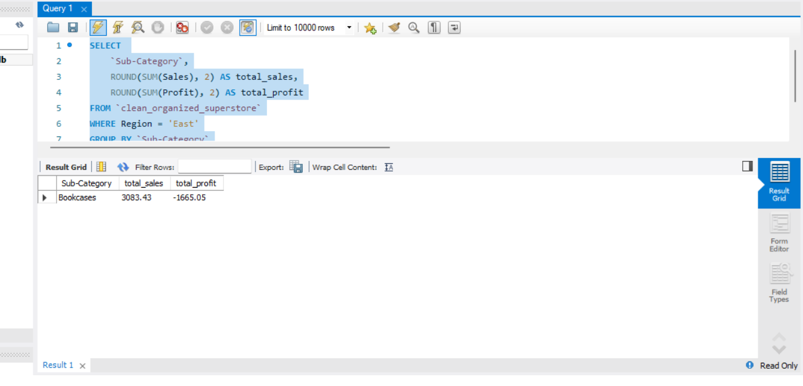

# Day -1/Project -1 /E-Commerce_superstore_sales
# Dynamic Sales Performance Optimization (E-Commerce)

## 📌 Project Overview
This project focuses on analyzing an e-commerce retail dataset containing ~10,000 transactions across 21 detailed business columns. The primary objective is to optimize regional sales performance by identifying low-margin product categories, high-return zones, and key customer segments across geographical regions.

## 📊 Dataset Structure
The dataset consists of **9,995 rows** and **21 columns**, capturing end-to-end transaction paths:
*   **Order Metadata:** Row ID, Order ID, Order Date, Ship Date, Ship Mode
*   **Customer Demographics:** Customer ID, Customer Name, Segment
*   **Geographic Dimensions:** Country, City, State, Postal Code, Region
*   **Product Details:** Product ID, Category, Sub-Category, Product Name
*   **Financial Performance Metrics:** Sales, Quantity, Discount, Profit

## 🛠️ Data Pipeline Architecture

### Phase 1: Data Cleaning & Integrity (Excel)
*   **Text Standardization:** Applied `=PROPER(TRIM())` to categorical fields (`Customer Name`, `Segment`, `City`, `State`) to remove trailing whitespace strings and fix irregular case errors.
*   **Data Type Integrity:** Transformed geographic zip codes into strict text attributes to preserve leading structural zeros. Checked currency vectors (`Sales`, `Profit`) for embedded non-numeric text symbols.
*   **Temporal Standardization:** Unified mixed raw date inputs (`DD-MM-YYYY` vs. `DD/MM/YYYY`) into a single, standardized format to support downstream time-series analysis.

### Phase 2: Relational Queries & Exploratory Analysis (SQL)
*   *Upcoming status: Writing complex window functions, aggregations, and ranking scripts to break down performance across Indian regions.*

### Phase 3: Interactive Visualizations (Power BI)
*   *Upcoming status: Developing a functional executive dashboard to track MoM growth metrics, active revenue health, and structural distribution gaps.*

# Day 2/Project -1 /E-Commerce_Superstore_sales
# Dynamic Sales Performance Optimization (E-Commerce)

## 📌 Project Overview
This project focuses on analyzing an e-commerce retail dataset containing 9,993 transactions across 21 detailed business columns. The primary objective is to optimize regional sales performance by identifying low-margin product categories, high-return zones, and key customer segments across geographical regions.

## 📊 Dataset Structure & Scale
*   **Total Volume:** 9,993 rows | 21 columns
*   **Order Metadata:** Row ID, Order ID, Order Date, Ship Date, Ship Mode
*   **Customer Demographics:** Customer ID, Customer Name, Segment
*   **Geographic Dimensions:** Country, City, State, Postal Code (formatted as Text), Region
*   **Product Details:** Product ID, Category, Sub-Category, Product Name
*   **Financial Metrics:** Sales, Quantity, Discount, Profit

## 🛠️ Data Pipeline Architecture

### ✅ Phase 1: Manual Data Cleaning & Integrity (Excel) - COMPLETED
To ensure 100% data integrity before database ingestion, a comprehensive manual audit was performed on all 9,993 rows:
*   **Text Standardization:** Applied `=PROPER(TRIM())` to categorical fields (`Customer Name`, `Segment`, `City`, `State`, `Product Name`) to remove hidden leading/trailing whitespaces and eliminate case-sensitivity anomalies that break dashboard filters.
*   **Anomalies & Glitches Resolved:** Detected and successfully eliminated all hidden structural `(Blanks)` within the **Region (Column M)** by cross-referencing geographic variables (City/State), achieving **zero blank cells** across the entire matrix.
*   **Data Type Enforcement:** Converted **Postal Code (Column K)** from a numerical scale to a strict **Text** format via the *Format Cells* wizard to preserve essential leading zeros.
*   **Mathematical Safety:** Audited financial column vectors (`Sales`, `Profit`, `Quantity`) to ensure zero text strings (`"null"`, `"N/A"`, `"-"`) were present, confirming the dataset is ready for mathematical aggregations.

### ⏳ Phase 2: Relational Queries & Exploratory Analysis (MySQL Workbench) - IN PROGRESS
*   *Current status:* Establishing schema definitions and preparing to ingest the clean tabular records into a relational database engine. Upcoming operations include complex window functions (`DENSE_RANK()`), regional margin calculations, and CTEs.

### ⏳ Phase 3: Interactive Visualizations (Power BI) - UPCOMING
*   *Upcoming status:* Developing a functional business intelligence dashboard tracking MoM growth rates, regional target spreads, and categorical performance matrixes.

# Day 3/project -1 /E-Commerce_superstore_sales
### ✅ Phase 2: SQL Business Analysis (Day 3 - COMPLETED)

#### Day 3 Finding: Which Region is in Loss?
**Business Question:** Which region of E-Commerce is Incurring Maximum Loss?

**Proof Executed:** `02-SQL/01_region_profit_loss_proof.png`

**Final Result:**
* **West Region:** +14.3% Profit (Healthy) ✅
* **Central Region:** -3.61% Loss
* **South Region:** -4.52% Loss
* **East Region:** -14.84% Loss (Critical) 🔴

> **Business Decision:** the region is eroding company profit by 14.84%. this indicates an immediate audit is required for discount strategy and shipping cost

# Day 4/project -1/E-Commerce_superstore_sales

### Objective: To Identify Loss-making sub-categories in the east region.

### SQL LOGIC USED:
- Filtered data for Region = 'East'
- Aggregated sales and profit using SUM()
- Grouped By sub-category to get granular profitability

#### KEY FINDING:
- Bookcases in East region is in loss: sales = 3083.43, profit = -1665.05
- Proof:

**Business INSIGHT:** East region Bookcases have negative profit margin due to high shipping/cost or low pricing. Requires pricing strategy and cost optimization.
### 🔗 Query 3: Advanced Regional Ranking via Window Functions
*   **Technical Execution:** Engineered an advanced relational script using `DENSE_RANK() OVER (PARTITION BY Region ORDER BY SUM(Profit) ASC)` to dynamically reset performance ranking loops across geographic boundaries.
*   **The Diagnostic Insight:** Isolated **Bookcases** as the single heaviest financial anchor in the **East Region**, ranking **#1 in net losses** with a structural deficit of **-1,665.05**.
*   **🎯 Executive Business Action:** Recommendation for immediate operational pivot—terminate low-margin clearance discounts on furniture variables in the East, increase minimum order thresholds for oversized freight items, and reallocate supply chain capital to the high-margin West region (14.3% margin baseline).
*